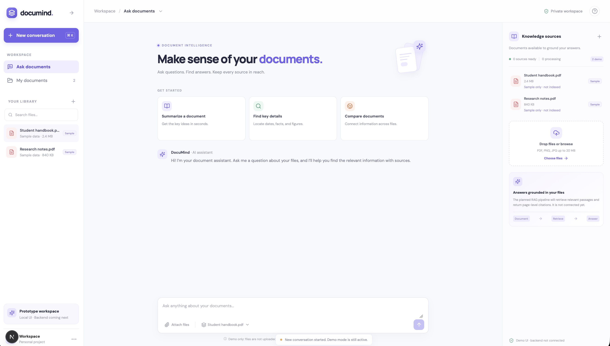

# Smart Virtual Assistant – Project Overview

This repository contains a **complete prototype** of a campus‑assistant application:

| Component | Location | Description |
|-----------|----------|-------------|
| **Backend** | `src/assistant/` | Rule‑based responder (`reply()`) and a tiny CLI (`python -m assistant`). Installed as an editable package (`pip install -e .`). |
| **Data** | `data/offices.csv` | CSV file with office names, rooms and opening hours used by the backend. |
| **UI (Streamlit)** | `ui/` | Planned Streamlit front‑end (`ui/app.py`). This README describes the UI design and how it directly imports `reply()`. |
| **Documentation** | `docs/` | Project‑level docs, onboarding guide, and UI mock‑up image (`docs/ui-mockup.png`). |
| **Tests** | `tests/` | Pytest suite for backend logic (`pytest -q`). |
| **Helper scripts** | `scripts/` | Utilities such as `scripts/check_env.py` for environment validation. |
| **Contribution guidelines** | `CONTRIBUTING.md` | How to submit patches, run linting, etc. |

## Installing & running the backend

```bash
# From the repository root
python -m venv .venv
source .venv/bin/activate
pip install -e .   # makes `assistant` importable
python -m assistant "help"   # quick sanity check
```

## Running the UI (once `ui/app.py` is created)

```bash
pip install streamlit
streamlit run ui/app.py
```

*The UI directly imports `assistant.rules.reply` – no HTTP API is required in this early phase.*

# UI Component — Smart Virtual Assistant

## Overview

The `ui/` directory contains the plan and (future) source code for the Smart Virtual Assistant user interface.
The UI will be built with **Streamlit** (Python), running in the same Python environment as the backend so it can call backend functions directly without a separate web server.

> **Current status:** Placeholder — no runnable code yet. This README describes the planned design and how the UI will connect to the backend.

## Reference Mockup

The UI design is inspired by the DocuMind prototype (`smartassistantprototype_version0.1`), a Next.js/React frontend scaffold for a document AI assistant.
A screenshot of the mockup is saved at:

```
docs/ui-mockup.png
```



### Key areas in the mockup

| Area               | Description                                                         |
|--------------------|---------------------------------------------------------------------|
| **Left sidebar**   | Document list / conversation history, "New conversation" button     |
| **Main area**      | Welcome header, suggestion cards, chat message list                 |
| **Chat input**     | Text input + send button, pinned to the bottom                      |
| **Right panel**    | Knowledge sources, document processing status (future enhancement)  |

## Planned UI Layout (Streamlit)

The Streamlit version will be a simplified adaptation of the mockup, suitable for the current rule-based backend:

```text
┌─────────────────────────────────────────────────┐
│  🎓 Smart Virtual Assistant                     │
│  HCMUS Study Assistant                          │
├─────────────────────────────────────────────────┤
│                                                 │
│  ┌─────────────────────────────────────────┐    │
│  │  💬 Conversation history                │    │
│  │  ┌───────────────────────────────────┐  │    │
│  │  │ User: where is the training       │  │    │
│  │  │       office?                     │  │    │
│  │  │ Bot:  Training office: room 301,  │  │    │
│  │  │       open 8:00-17:00.            │  │    │
│  │  └───────────────────────────────────┘  │    │
│  └─────────────────────────────────────────┘    │
│                                                 │
│  ┌─────────────────────────────────────────┐    │
│  │ 📝 Ask a question:                     │    │
│  │ [____________________________] [Send]   │    │
│  └─────────────────────────────────────────┘    │
│                                                 │
│  💡 Try: "help" | "training office"             │
│         | "where is ...?"                       │
└─────────────────────────────────────────────────┘
```

## How the UI Connects to the Backend

### Direct Python import (same process)

The Streamlit app will **directly import** the `reply()` function from the backend module. No HTTP requests, no REST API, no separate server — the UI and backend run in the **same Python process**.

```python
# ui/app.py (planned)
from assistant.rules import reply

user_input = st.chat_input("Ask a question...")
if user_input:
    answer = reply(user_input)   # Direct function call, no network
    st.write(answer)
```

This works because the project is installed as an editable package (`pip install -e .`), which makes the `assistant` module importable from anywhere in the same virtualenv.

### Data flow diagram

```text
┌──────────────┐                    ┌────────────────────┐                    ┌───────────────┐
│  Streamlit   │  python import     │  assistant.rules   │  load_offices()   │  data/        │
│  UI          │ ─────────────────► │                    │ ────────────────► │  offices.csv  │
│  (ui/app.py) │                    │  reply(message)    │                    │               │
│              │ ◄───────────────── │                    │ ◄──────────────── │  name, room,  │
│  Display     │  return str        │  Rule matching     │  dict[str, dict]  │  hours        │
│  answer      │                    │  + greeting check  │                    │               │
└──────────────┘                    └────────────────────┘                    └───────────────┘

Step 1: User types a question in Streamlit text input
Step 2: Streamlit calls  reply(question)  — a plain Python function call
Step 3: reply() loads office data from  data/offices.csv  (cached as dict)
Step 4: reply() matches the question against greetings, "help", or office names
Step 5: reply() returns an answer string
Step 6: Streamlit displays the answer in the chat UI
```

### The `reply()` function

The backend exposes `reply(message: str) -> str` in [`src/assistant/rules.py`](../src/assistant/rules.py).
It is a **synchronous, pure function** — no async, no side effects, no state.

| Input example                 | Output                                                       |
|-------------------------------|--------------------------------------------------------------|
| `""` (empty)                  | `"Please type a question."`                                  |
| `"hello"`, `"hi"`, `"chao"`  | `"Hello! Ask me where an office is, or when it opens."`      |
| `"help"`                      | `"I can help you find office locations, check opening..."`   |
| `"training office"`           | `"Training office: room 301, open 8:00-17:00."` (example)   |
| No match                      | `"I don't know that yet. Try asking about an office..."`     |

### Data source

- File: [`data/offices.csv`](../data/offices.csv)
- Format: CSV with columns `name`, `room`, `hours`
- Loaded automatically by `load_offices()` on first call to `reply()`

## File Plan

```text
ui/
├── README.md       ← This file (plan and documentation)
└── app.py          ← (To be created) Streamlit placeholder app
```

## How to Run (once app.py is created)

```bash
# From the project root
source .venv/bin/activate
pip install streamlit
streamlit run ui/app.py
```

## Roadmap

| Phase   | Description                                                  | Status         |
|---------|--------------------------------------------------------------|----------------|
| Phase 1 | README plan + mockup in `docs/`                              | ✅ Done        |
| Phase 2 | Create `app.py` Streamlit placeholder                        | 🔲 Not started |
| Phase 3 | Wire UI to `reply()` backend, display chat history           | 🔲 Not started |
| Phase 4 | Enhanced UI: sidebar, suggestion cards, styling              | 🔲 Not started |
| Phase 5 | Migrate to REST API when backend scales up (FastAPI)         | 🔲 Not started |

## Prototype Reference

The UI design references the DocuMind prototype (`smartassistantprototype_version0.1`):
- **Original stack:** Next.js + React + TypeScript + CSS
- **Key features:** Document chat, file upload, knowledge sources panel, suggested questions
- **Prepared API contract:** REST endpoints (`POST /api/v1/chat`, `POST /api/v1/documents`, etc.)
- **Prototype status:** Frontend-only, not connected to a real backend

Streamlit was chosen over the Next.js prototype for the current project because:
1. **Same language** — Python backend can be imported directly, no API layer needed
2. **No build step** — simple deployment with `streamlit run`
3. **Rapid prototyping** — well-suited for the early rule-based phase of the project
